# Meridian administrator training

A course for the customer's Meridian administrator and the SAP Basis colleague who connects Meridian to SAP. It
takes you from an empty Linux host to a deployment that is installed over HTTPS, licensed, connected to SAP with a
read-only role, extracting on a schedule, scoring, routing fixes and backed up.

Work through the modules in order. Each one has learning objectives, steps, checks ("you should now see ...") and a
short exercise. Every setting, route and command named here exists in the release this edition describes. The
screenshots are taken from the product's demo build with sample data (the "Demo data" bar at the top of each one);
your own deployment shows your data and never shows that bar.

Who does what:

- **Meridian administrator**: modules 1 to 3 and 6 to 10.
- **SAP Basis**: modules 4 and 5, and the SAP side of module 7.

## Module 1: Install and first start

### Learning objectives

- Check the host against the prerequisites before installing.
- Run the installer, choose an HTTPS mode and know what each one does.
- Sign in for the first time and change the administrator password.
- Read the health endpoints and the health checks.

### Prerequisites

- A Linux host with Docker 24 or later, `curl`, `python3` and `openssl`, run as root (`sudo`).
- Outbound HTTPS to the licence server (online licence) or an offline licence token (air-gapped).
- A DNS name for the host if you want a Let's Encrypt certificate.
- Network access from the host to the SAP application servers (RFC) or the SAP cloud APIs.
- `gpg` for encrypted backups (module 9).

`scripts/preflight.sh` checks the host before you start.

### Steps

1. Run the installer: `sudo bash scripts/meridian-deploy.sh`. It asks for the server name, the LLM tier, the SSL
   mode, and the first administrator (`ADMIN_EMAIL`, `ADMIN_NAME`, `ADMIN_PASSWORD`), writes `.env` with fresh
   secrets, migrates the database, creates the administrator with `scripts/manage_users.py` and starts the stack.
   For unattended installs pass `--non-interactive` with a filled `.env`; for private registries or air-gapped
   hosts see `--image-source registry` and `--image-source local --image-tarball <path>`.
2. Choose the **SSL mode**:
   - `1`: no TLS, HTTP only. For a closed test network only.
   - `2`: a self-signed certificate. The installer enables HTTPS in nginx with `scripts/nginx-https.sh`: port 443
     serves Meridian and port 80 answers every request except the health probes with a redirect to HTTPS.
   - `3`: a Let's Encrypt certificate for the server name, enabled the same way.
3. Open the address the installer prints and sign in with the administrator email and password.
4. **Change the password.** Meridian asks for a new password before anything else when an account carries the
   "must change password" flag: the seeded development account (`admin@meridian.local`), and any account an
   administrator has reset. The new password must have at least 12 characters, must not be the email name, a common
   password or the current one.
5. Read the health:
   - `https://<server>/health` is the readiness probe. It answers `200` with `status: ok` only when Postgres and
     Redis answer, and `503` with `status: degraded` and the state of each component otherwise. It also reports
     the version, the model provider, the cached licence and the email backend.
   - `/health/live` is the liveness probe inside the stack: it answers whenever the API process runs, without
     touching Postgres or Redis, so a restart policy never cycles the API for a short database outage. nginx does
     not publish it; read it with `docker compose exec api curl -s http://localhost:8000/health/live`.
   - The installer writes `/opt/meridian/healthcheck.sh`, which checks each container in turn.
   - In the product: **Administration, Platform and updates, Health checks** (database, cache and queue, background
     workers, licence, email delivery, file storage), refreshed every 30 seconds.

`scripts/update.sh` re-applies HTTPS after every update when a certificate is present, so an update never falls
back to HTTP.

The interactive API documentation (`/docs`, `/redoc`, `/openapi.json`) is not served on a production deployment:
it answers only when `MERIDIAN_ENV=development` or `MERIDIAN_OPENAPI_PUBLIC=1` is set, because nginx proxies those
addresses without sign-in.

### Checks

- You should now see the sign-in page over `https://` (SSL mode 2 or 3), and `http://<server>/` redirect to it.
- After the password change you should land on the Landscape with **Administration** in your account menu.
- `curl -s https://<server>/health` should print `"status": "ok"`.

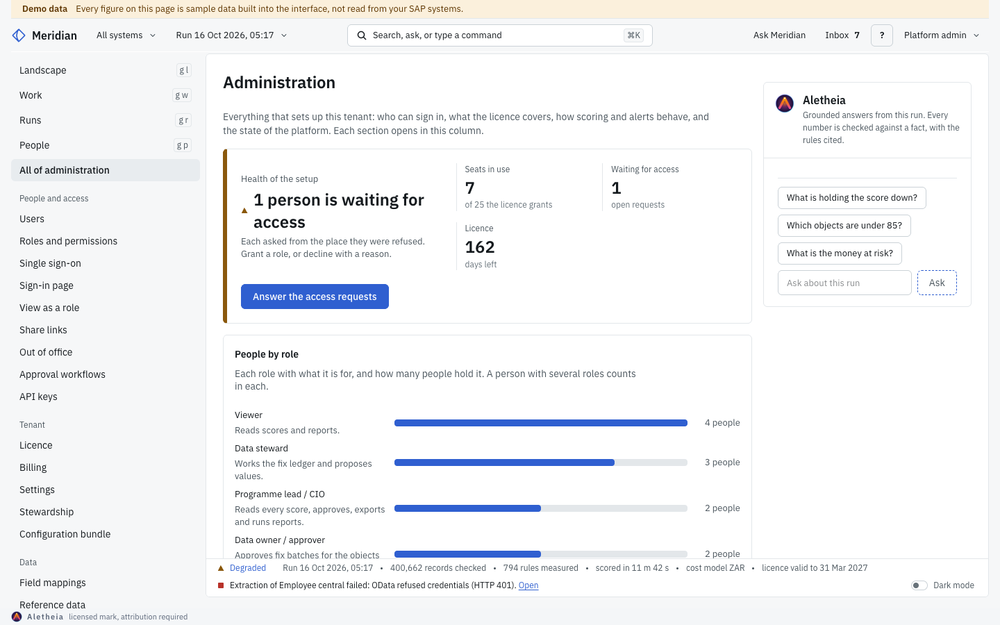

### Exercise

Stop Redis for a minute (`docker compose stop redis`), call `/health` and note the `503` and which component reads
`down`; check that `/health/live` still answers; start Redis again (`docker compose start redis`).

## Module 2: Licence

### Learning objectives

- Know how online and offline licences are validated, and what they unlock.
- Understand the Ed25519 transition window and when to turn it off.
- Know what the 14-day offline grace does and what users see before and after it.

### How a licence is checked

Every licence path is verified against the vendor's Ed25519 public key compiled into the image
(`api/middleware/licence_keys.py`): the online validation response, the offline token and the offline file alike.
There is no key to set in `.env`, and an unsigned or wrongly signed licence grants nothing.

- **Online** (`MERIDIAN_LICENCE_MODE=online`, the default): the API sends `MERIDIAN_LICENCE_KEY` to
  `MERIDIAN_LICENCE_SERVER_URL` and caches a valid answer for 6 hours.
- **Offline** (`MERIDIAN_LICENCE_MODE=offline`): `MERIDIAN_LICENCE_TOKEN` holds a signed token issued by Meridian HQ,
  for air-gapped hosts. It never phones home.

### The transition window

`MERIDIAN_LICENCE_ALLOW_LEGACY_SIGNATURES` is `true` by default in this release. While it is on, Meridian also
accepts the older signatures (an HMAC-signed offline file, an RS256 offline token, an RSA-signed online response
and, with no RSA key configured, an unsigned online response), and logs each acceptance. It exists because the
licence worker at Meridian HQ is deployed separately: an installation that updated before the worker signs with
the vendor key would otherwise refuse its own licence.

Turn it off (`MERIDIAN_LICENCE_ALLOW_LEGACY_SIGNATURES=false` in `.env`, then restart the API) once Meridian HQ
confirms the licence worker signs with the vendor key. A later release makes `false` the default.

### The offline grace

When the licence server cannot be reached, the last valid signed response is honoured for
`MERIDIAN_LICENCE_OFFLINE_GRACE_DAYS` (default 14, at most 30) days after it was signed. It is kept on disk at
`MERIDIAN_LICENCE_STATE_PATH` (default `/var/lib/meridian/licence-last-valid.json`) and re-verified when it is
loaded, so a restart keeps the grace and editing the file grants nothing.

What people see:

- **During the grace** everything keeps working. `GET /api/v1/licence` reports status `offline_grace` with when the
  response was signed, when the grace ends and the days left; every gated API answer carries the header
  `X-Licence-Warning: offline_grace`, and the API log warns. The Licence page in Administration still reads
  **Valid**, so watch the status and the log rather than the screen.
- **After the grace** gated routes answer `403` with `licence_server_cutoff`, and people are sent to the "Licence
  needed" page: "Meridian HQ could not be reached to validate the licence".

### Steps

1. Open **Administration, Licence**. Read the company, status, tier, seats, validity, last checked, platform version
   and the licensed modules and features.
2. Press **Check with Meridian HQ now** to validate at once instead of waiting for the cache.

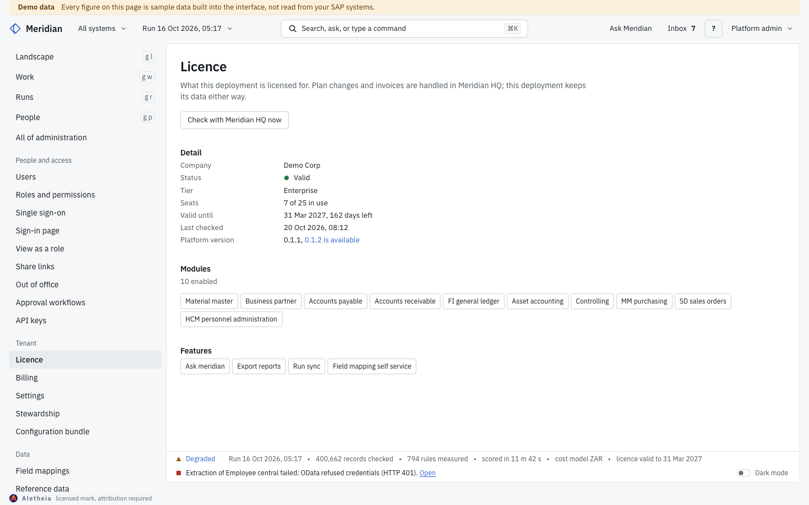

### Checks

- You should now see **Valid** and the expiry date with the days left.
- `curl -s https://<server>/health` shows the same licence in its `licence` field.

### Exercise

Find in `.env` which licence mode this deployment uses, and write down the date by which you will turn the
transition window off. Then answer: if the licence server is unreachable from Friday evening, until when does
Meridian keep working?

## Module 3: Users and access

### Learning objectives

- Invite people and give them roles, scoped where needed.
- Connect single sign-on and decide whether to require it.
- Provision people with SCIM and map identity provider groups to roles.
- Issue API keys, and read the sign-in events in the audit log.

### Roles

A person's roles are grants. Built-in roles cannot be changed; copy one to make a custom role. A grant can be
scoped to one system or object, and can expire. The roles include platform admin, programme lead, data steward,
data owner, SAP Basis, process analyst, analyst, auditor and viewer; each has its own start screen, and the account
button names the person's role. **Administration, Roles and permissions** shows the matrix "What each role may do".

### Steps

1. **Administration, Users**: **Invite a user** with an email and roles, or **Import users** from a CSV with a
   preview. The seat meter counts active and invited users against the licence. Invitations expire after 7 days;
   resend or copy the link from the person's row.
2. **Administration, Single sign-on**: OpenID Connect with your identity provider (Microsoft Entra ID, Okta). Enter
   the issuer address, client ID and client secret ("Stored encrypted and never shown again."), register the
   redirect address shown there at the provider, then **Test sign-in**. People who sign in for the first time get
   the Viewer role and no access grants.
3. **Administration, Sign-in page**: the allowed email domains and **Require single sign-on**. Password sign-in then
   stops for everyone except administrators, who keep it as a way in if the provider is down. Ten failed sign-ins
   lock an account for 15 minutes.
4. **Administration, Users, Provisioning (SCIM)**: **Create a token**, then give your identity provider the SCIM
   base URL (`/scim/v2`) and the token. Under **Group to role**, map identity provider groups to Meridian roles;
   saving re-syncs everyone in a SCIM group. **Rotate the token** stops the old one at once; **Revoke** stops
   provisioning (people keep their accounts).
5. **Administration, API keys**: a key acts as its own service account with only the roles you give it, and shows
   in the audit log under its name. The key is shown once, when you create it.
6. **Administration, Audit log**: every change, by whom and when, with filters by person, action, object kind and
   dates, and **Export CSV** and **Export Excel**. Sign-in events are recorded too: `auth.login`,
   `auth.login_failed` (the email as typed and the reason, never the password), `auth.lockout`, `auth.logout`,
   `auth.password_change`, and for single sign-on `auth.sso_login`, `auth.sso_refused` and
   `auth.sso_user_created`.

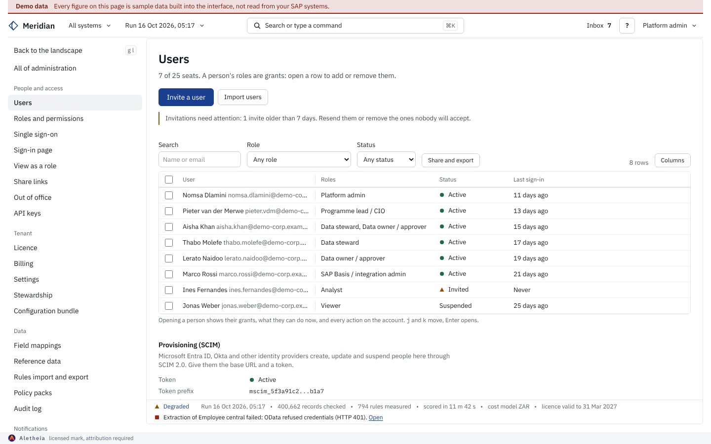

Signed-in requests run in the tenant named by the verified token, never a fixed one. `MERIDIAN_TENANT_ID` sets this
deployment's own tenant, used for sign-in, the pages before sign-in, API keys and the HQ manifest; a single-tenant
installation keeps the default.

### Checks

- You should now see the invited person with status **Invited**, and after they accept, **Active**.
- In the audit log, filtering on the action `auth.login` should list your own sign-in.

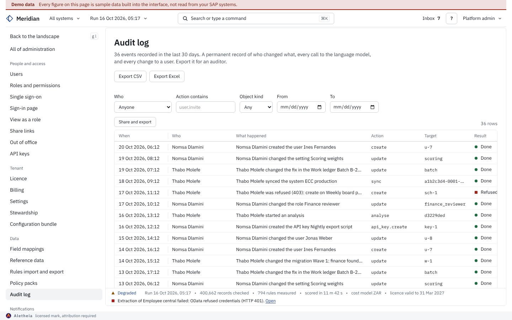

### Exercise

Invite a colleague as a viewer, scope a data steward grant to Material master only, sign in with a wrong password
three times from a test account, and find the three `auth.login_failed` rows in the audit log.

## Module 4: Connecting SAP

### Learning objectives

- Choose the system type and fill in the connection.
- Create the read-only SAP role from the template.
- Choose the table reader your Basis team accepts.
- Test the connection and read connection health; connect a cloud system.

### System types

ECC, S/4HANA on premise, Extended Warehouse Management (RFC, user and password), S/4HANA Cloud (OData V4, OAuth
2.0), SAP BTP (OData, XSUAA OAuth 2.0), SuccessFactors (OData V2, basic or OAuth 2.0), Concur (REST, OAuth 2.0) and
Ariba (REST, OAuth 2.0 and an API key).

### The read-only role (SAP Basis)

`docs/sap/authorisation-role-template.md` is the PFCG role for the RFC user: copy it into a role such as
`Z_MERIDIAN_READ` and assign it to a system or communication user (SU01 type B or C). It grants:

- `S_RFC` (`ACTVT = 16`) on the named function modules only: `RFC_PING`, `RFC_SYSTEM_INFO`, `DDIF_FIELDINFO_GET`,
  `RFC_GET_FUNCTION_INTERFACE`, `RFC_METADATA_GET`, optionally `EM_GET_NUMBER_OF_ENTRIES`, and one table reader.
- `S_TABU_NAM` (preferred) or `S_TABU_DIS` with `ACTVT = 03` on the tables of the modules you extract, the data
  dictionary, organisational structure and, for delta extraction, `CDHDR` and `CDPOS`.
- No transaction codes, no `S_DEVELOP` and no change activity. With this role Meridian cannot change SAP data.

### Choosing the table reader

Set `MERIDIAN_RFC_READ_FUNCTION` in `.env`:

| Value | Reader |
|---|---|
| `RFC_READ_TABLE` (default) | 512-byte rows; wide tables are read in column groups and joined on the key |
| `/BODS/RFC_READ_TABLE2` | the Data Services reader, rows up to 30,000 bytes; wide tables in one pass |
| `BBP_RFC_READ_TABLE` | the SRM reader, the same interface as `RFC_READ_TABLE`; some sites allow it when they refuse `RFC_READ_TABLE` |
| `auto` | probes `RFC_FUNCTION_SEARCH` for `/BODS/RFC_READ_TABLE2`, then `BBP_RFC_READ_TABLE`, else `RFC_READ_TABLE` |

The extracted data is the same whichever reader is used. Grant `RFC_FUNCTION_SEARCH` only with `auto`.

### Steps

1. Connect a system from the command line ("Connect a system") or at `/s/new`. Name it, choose the **System type**
   and the **Environment**, then for RFC systems **Host**, **Client** (3 digits), **Instance number** (2 digits) and
   an optional **User** (empty uses the deployment's default RFC user, `SAP_RFC_USER`), with the password under
   **Sign-in secrets**. Cloud systems ask for their base URL and OAuth details instead.
2. **Test connection**. A passing test reads like "RFC connection succeeded (client 100, 41 ms)".
3. **Connect system**. Nothing is read from SAP until you extract.
4. If SAP host names resolve only on your corporate DNS, set `MERIDIAN_DNS_1` (and `MERIDIAN_DNS_2`) in `.env`;
   `scripts/dns-overlay.sh` gives the API and worker those resolvers, and the installer and `update.sh` apply it.
   Without them containers use the host's resolver.

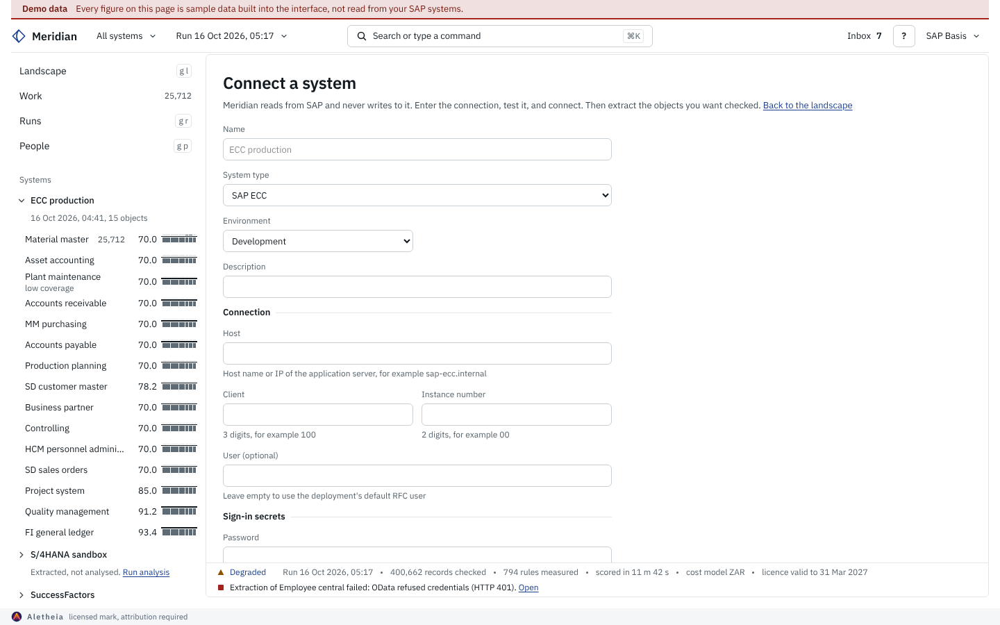

### Checks

- You should now see the system on the map and, for the SAP Basis role, a row under **Connections** on the Basis
  home with "Connected" and what the last test said.
- A table the user may not read shows "No authorisation to read this table. The user needs read access to it."; SU53
  on the SAP side shows the failed check.

### Exercise

With your Basis colleague, generate the role from the template on a quality system, set
`MERIDIAN_RFC_READ_FUNCTION=auto`, test the connection, and note which reader the first extraction used in the job
inspector.

## Module 5: Extraction, runs and schedules

### Learning objectives

- Start and schedule extractions and analyses.
- Use dry runs and delta extraction.
- Read the jobs view and triage failed jobs from the Basis home.

### Steps

1. **Dry run**: in the system inspector choose the objects and press **Dry run**. It shows what an extraction would
   read, without reading it: rows per table from the last extraction and an estimated duration.
2. **Administration, Start and schedule** (the runs themselves are on **Runs**): **Start an extraction** with the
   objects, company codes, plants, a document date window and **Analyse straight after extracting**; **Changes only
   since last full download** reads only records changed since the last full download (delta). A delta runs as a
   full extraction when the last full one is older than `MERIDIAN_DELTA_FULL_DAYS` (default 7). **Start an
   analysis** scores a stored extraction; **Load configuration** reads the configuration tables; **Upload a file**
   turns a CSV, TSV, Excel, JSON or Parquet file of one object into a run.
3. Every start form shows its prediction first: duration band, records, cost (from the cost model's run cost) and
   queue position.
4. **Scheduled runs**: **Schedule a run** with a rhythm and **Changes** or **Everything**. Times are UTC. Due runs
   start within 5 minutes of their time.
5. **Runs, Jobs**: every extraction, analysis and configuration load with its state. Open a failed job for its
   stages, the error in plain words and **Retry**.
6. **The Basis home**: SAP Basis lands on the landscape with what they look after above the coverage matrix:
   **Connections** (health and what the last test said), **Last extraction** per system with records and state,
   **Failed jobs to triage** (a failed job not followed by a success of the same kind), **Authorisation errors**
   (refused credentials and missing authorisations from the tests and jobs) and **Schedules** with the next run and
   the mode.

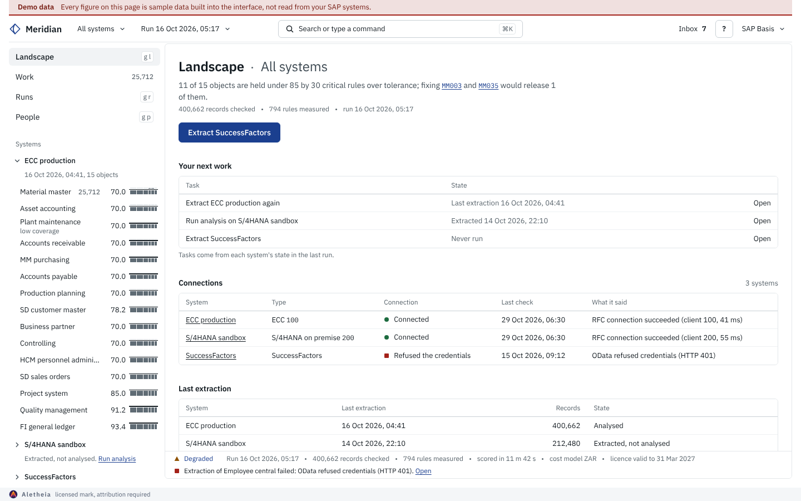

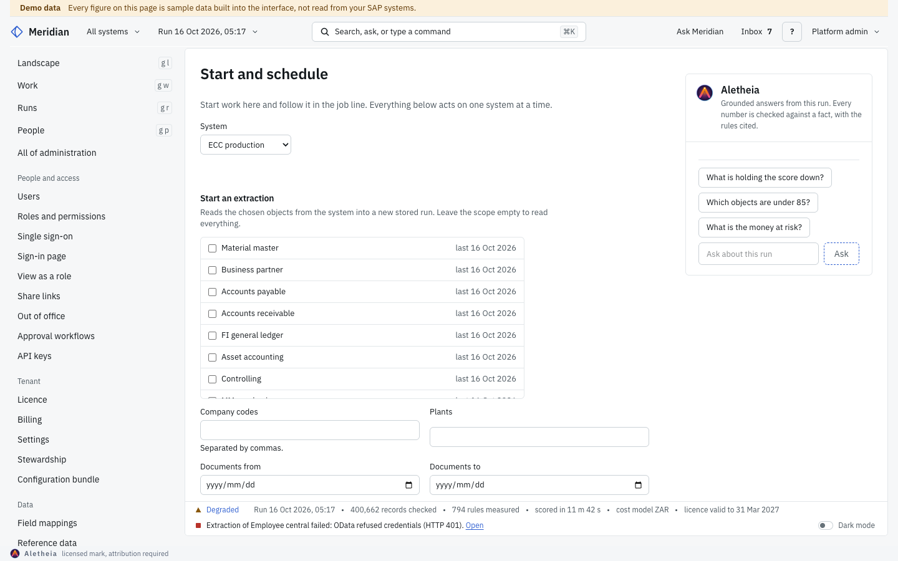

### Checks

- You should now see the run on **Runs** with its records, rules, score range and status.
- A failed extraction should appear once under **Failed jobs to triage** and disappear after a successful retry.

### Exercise

Schedule Material master on Mondays at 04:00 UTC as **Changes**, then dry run it and compare the predicted duration
with the actual one after Monday's run.

## Module 6: Scoring and money

### Learning objectives

- Read the score formula, the cap and the measured score.
- Set the cost model and know why money is an estimate until it is saved.
- Apply a policy pack.

### The score

```
DQS = 0.25 x Completeness + 0.25 x Accuracy + 0.20 x Consistency
    + 0.10 x Timeliness + 0.10 x Uniqueness + 0.10 x Validity
```

Each dimension score averages the record-level pass rates of its rules. The cap rule is fixed: one critical rule
over tolerance caps the score at 85, two or more at 70. A critical rule is over tolerance when it fails at least
the share or the number of records set under **Administration, Settings, Cap rule and tolerance** (by default 10%
of rows or 25 rows).

Where a cap applies, the score reads with both numbers, for example "70.0 capped, 71.8 measured", and the receipt
says "Measured 71.8, the tick on the ruler. Capped at 70 by MM003 and MM035, two critical rules over tolerance." The
landscape and the map rank objects by the measured score, so capped objects still sort by how good they are.

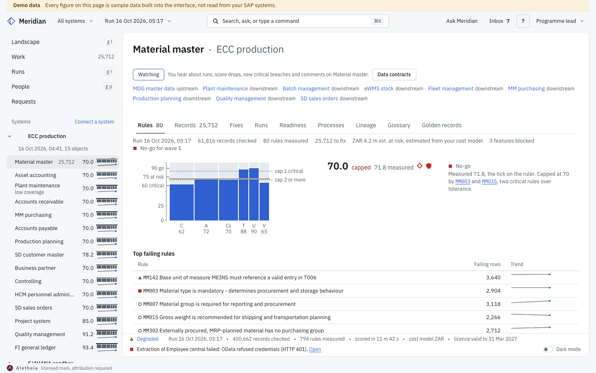

### Money is an estimate

Every amount (value at risk, ROI, planner figures) comes from the tenant's cost model: the cost of one failing
record by severity. Every amount carries the marker **est.**. Until the tenant saves its own cost model, the figures
use the shipped starting assumptions: the marker reads **default estimate** and the note says "an estimate from
default assumptions; set your cost model in Administration".

### Steps

1. **Administration, Settings**: check **Dimension weights** (they must add up to 100; **Use the DAMA defaults**),
   **Score bands**, **Cap rule and tolerance**.
2. **Cost model and currency**: set the currency and the cost of one blocked record by severity, then **Save cost
   model**. The run cost (per worker hour and per million records) feeds the run prediction.
3. **Administration, Policy packs**: GxP, SOX and GDPR. **Apply the pack** marks failing critical rules of its
   classes as policy breaches on the landscape, the ruler and the receipt.

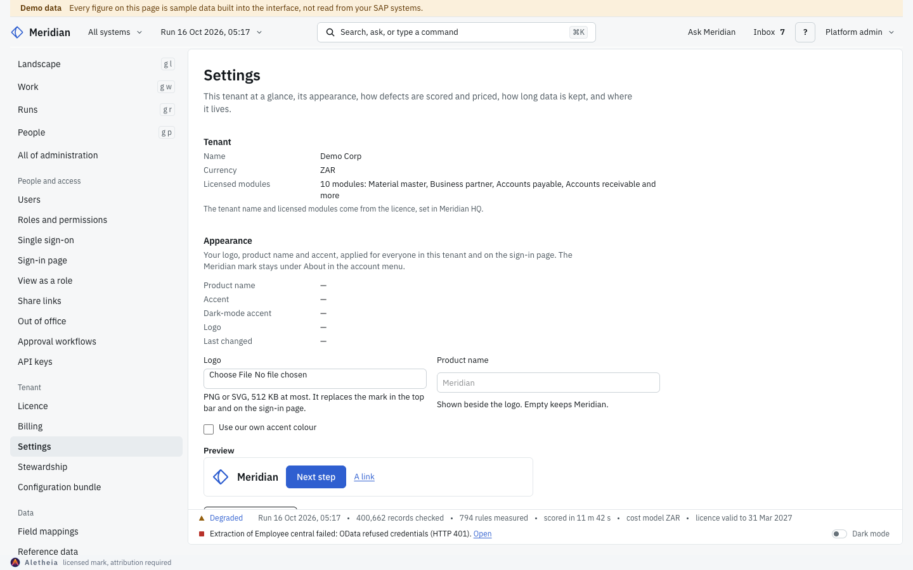

### Checks

- You should now see amounts marked **est.** instead of **default estimate**.
- A change to weights or tolerance applies to the next analysis; scores stored with earlier runs stay as they were.

### Exercise

Before saving the cost model, find one amount marked **default estimate** on Work. Save your cost model, reload and
check the marker reads **est.**

## Module 7: Fixing data and write-back

### Learning objectives

- Know how fixes flow from the Work ledger to SAP, with four eyes.
- Enable live write-back for the objects that support it, and read SAP's answer.
- Know what stays export-only.

### The flow

1. Stewards decide rows in **Work**: accept the suggested value, type a new value, or mark not an issue or accept
   risk. A change of more than 25 rows, from a key or an **Accept all** button, waits on a confirmation bar with the
   count: Enter confirms, Escape keeps the rows.
2. Decided values collect in a fix batch, which waits for a second person (**Waiting for approval**). Nobody approves
   their own batch.
3. An approved batch is sent with **Send to SAP**: the approved values leave as a Migration Cockpit load file that
   your own process loads. The next run confirms each record.

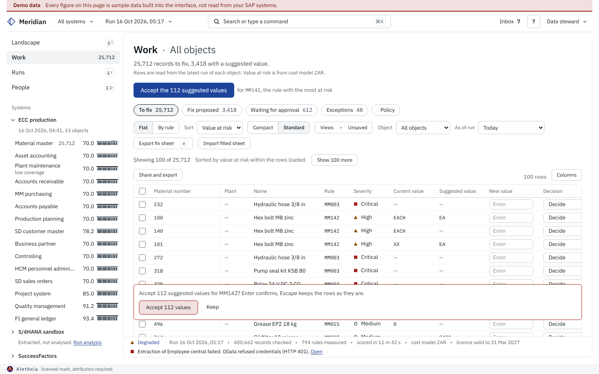

### Live write-back

Live write-back is off by default. With `MERIDIAN_LIVE_WRITEBACK_ENABLED=true` in `.env`, the flow is on screen: the
inspector of an approved batch shows **Live write-back** (GET `/api/v1/settings` reports `live_writeback: true`).
**Check with SAP** lists every field of the batch with BAPI or Export and the reason, and sends nothing; **Send to
SAP**, for an approver who did not build the batch, confirms with the record count and shows the result per record
with SAP's RETURN messages, and a summary of records sent, records failed and fields left for the export. The load
file stays available as **Export load file**. The same write-back is still open to scripts through the API
(`POST /api/v1/writeback`, approved by a second person at `POST /api/v1/writeback/approve/{id}`; the screen uses
`POST /api/v1/writeback/batches/{id}/check` and `/send`). Either way it is applied to ECC, S/4HANA on premise or EWM
through standard BAPIs:

- **Material master**: `BAPI_MATERIAL_SAVEDATA`.
- **Business partner**: `BAPI_BUPA_CENTRAL_CHANGE` and `BAPI_BUPA_ADDRESS_CHANGE`.
- **Customer** (SD customer master and accounts receivable): `BAPI_CUSTOMER_CHANGEFROMDATA1`.

For each record Meridian checks the BAPI's interface on the connected system, simulates the call (`TESTRUN`, or a
call followed by `BAPI_TRANSACTION_ROLLBACK`; the customer BAPI is simulated by the interface check only, because it
may commit by itself), and commits with `BAPI_TRANSACTION_COMMIT` only when SAP's RETURN table holds no `E` or `A`
message. Every RETURN message (type, id, number, text) is kept per record in the answer and in `write_back_log`; no
field value is logged. A field without a mapping is reported per field with its reason and goes out by export.

Live write-back needs change authorisations, so it uses a **separate** SAP role on a **separate** user, approved by
its own process (the template lists the BAPIs and objects). Never add them to the read-only role. Sandbox mode holds
every write-back back.

**Export only**: every other object, including the classic vendor master (`LFA1`, `LFB1`, `LFM1`), whose
maintenance class is not remote-enabled: vendor fixes leave as a load file, or through the business partner where
the vendor is one. Live write-back has not yet been run against a live SAP system by the vendor; run it first on a
quality system.

### Checks

- With write-back off, an approval answers that live write-back is off on this deployment and points to the export.
- With it on, a record SAP refuses reads "SAP refused the change; see its RETURN messages" and nothing is committed.

### Exercise

On a quality system, with live write-back on, open an approved batch of material master fixes, run **Check with
SAP**, then **Send to SAP** as a second person, and read the simulation messages and the commit messages for each
record. Then try a vendor master field and read the reason it goes out by export.

## Module 8: Notifications and integrations

### Learning objectives

- Set the tenant's default digest and scheduled digests.
- Add webhooks for Slack, Teams or any https endpoint.

### Steps

1. **Administration, Alerts**: channels (email, Microsoft Teams, signed webhook), **When to alert** and **Score floors
   per object**. Alerts carry counts, rule ids and links, never record values.
2. **Administration, Default digest**: the summary the tenant gets by default. Each person sets their own digest
   under Preferences.
3. **Administration, Digests**: scheduled summaries for a role or a migration wave, with cadence, time zone and
   channel; **Preview**, **Send now**, **Pause** and the delivery log. Email needs the `SMTP_*` or Microsoft Graph
   settings; without them an email digest is recorded as failed with the reason.
4. **Administration, Webhooks**: **Add a webhook** with the URL of a Slack or Teams workflow, or any https endpoint,
   and the events it should receive. Meridian posts a signed JSON event (ids, names and numbers, never SAP values);
   a failed post is retried after 1, 2, 4 and 8 minutes and marked failed after 5 attempts.
5. Set `MERIDIAN_APP_URL` in `.env` so links in digests, webhooks and invitations open your deployment.

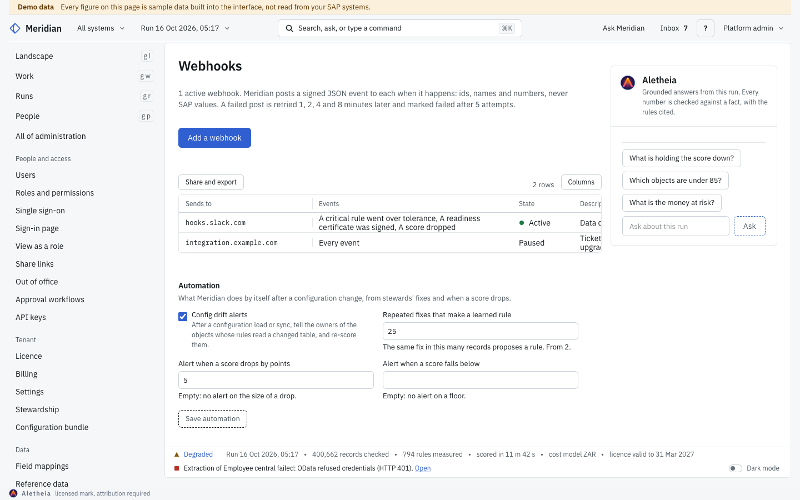

### Checks

- You should now see the webhook as **Active**, and a test delivery in its log.

### Exercise

Create a Teams workflow that receives a webhook, add it for the `digest.sent` event, and send a digest now.

## Module 9: Operations

### Learning objectives

- Back up and restore, with the `.env` encrypted.
- Update, pin a version and roll back.
- Know log rotation, DNS, the diagnostics bundle, the status page and sandbox mode.

### Backups

`scripts/backup.sh` writes `backups/<timestamp>/` with the database dump, the object storage, a manifest, and the
`.env` file encrypted with GPG (`env.gpg`), because `.env` holds the master keys. It prompts for the passphrase; for
cron, give it a root-only passphrase file:

```
sudo bash scripts/backup.sh --passphrase-file /root/.meridian-backup-pass --output /var/backups/meridian
```

With no terminal and no passphrase file the backup stops rather than writing `.env` in clear. `--plain-env` opts out
(writes `env.txt`, mode 600). `MERIDIAN_BACKUP_PASSPHRASE_FILE` can stand in for the flag.

Restore with `sudo bash scripts/restore.sh <backup-dir>`; it decrypts `env.gpg` with
`MERIDIAN_BACKUP_PASSPHRASE_FILE` when set, else it prompts. `--drill` restores into a temporary database without
touching the real one: run it monthly.

### Updates and rollback

- **Administration, Platform and updates** shows the running and the latest version; **Update to** starts the
  update through the updater sidecar. On the host: `sudo bash scripts/update.sh`.
- `update.sh` tags the current images `:rollback`, pulls, migrates and probes `/health` before it declares success;
  `sudo bash scripts/update.sh --rollback` returns to the previous images. Rollback restores images, not the schema.
- `MERIDIAN_VERSION` in `.env` sets the Meridian image tag; a fixed tag holds the stack at that release.

### Logs, DNS and images

- Every container rotates its logs: at most 5 files of 50 MB each.
- Redis is pinned to `redis:7.2-alpine` (7.4 and later are not open source) and Ollama to a fixed release.
- DNS: the host's resolver by default; `MERIDIAN_DNS_1` and `MERIDIAN_DNS_2` override it (module 4).

### Support and safety

- **Download diagnostics bundle** under Administration, Platform and updates: versions, health checks, recent errors
  and configuration with every secret removed. It holds no SAP record values.
- **The status page** at `/status` is readable signed out.
- **Sandbox mode** (Administration, Settings): copies the latest run; decisions land on the copy and notifications,
  webhooks, digests, report mailouts and write-backs are held back until you exit.

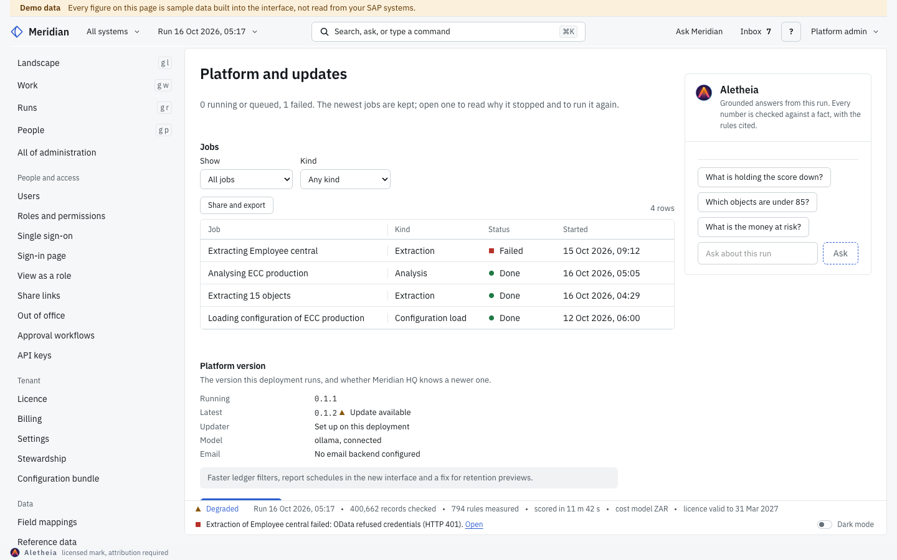

### Checks

- `backups/<timestamp>/env.gpg` should exist and `env.txt` should not.
- `sudo bash scripts/restore.sh --drill <backup-dir>` should exit 0.

### Exercise

Create the passphrase file, schedule the nightly backup in cron, run one restore drill, and record the time it took
as your restore time.

## Module 10: Troubleshooting

| Symptom | Cause | Fix |
|---|---|---|
| `http://` works but `https://` refuses | SSL mode 1 was chosen, or no certificate in `nginx/certs` | Re-run the installer with SSL mode 2 or 3; `update.sh` keeps HTTPS on afterwards |
| Sign-in goes straight to a password change | The account must change its password (first start or admin reset) | Set a password of 12 or more characters that is not the email name or a common one |
| "10 failed sign-ins lock the account for 15 minutes" | Lockout after failed sign-ins (`auth.lockout` in the audit log) | Wait 15 minutes, or reset the password under Users |
| `/health` answers 503 `degraded` | Postgres or Redis does not answer | `docker compose ps`, then the logs of `db` or `redis` |
| `/docs` answers 404 | API docs are hidden outside development | Set `MERIDIAN_OPENAPI_PUBLIC=1` only where nginx is not public |
| "Licence needed": Meridian HQ could not be reached | The licence server was unreachable past the offline grace (`licence_server_cutoff`) | Restore outbound HTTPS to the licence server; check `X-Licence-Warning` and `offline_grace` days earlier |
| A licence is refused after an update | Legacy signature with the transition window off | Set `MERIDIAN_LICENCE_ALLOW_LEGACY_SIGNATURES=true` until HQ issues an Ed25519-signed licence |
| Connection test: "Sign-in refused" or HTTP 401 | Wrong or expired user or secret | Connection settings: type the new values and test again |
| "No authorisation to read this table" | The RFC user lacks `S_TABU_NAM` or `S_TABU_DIS` on that table | Add it from the role template; SU53 shows the check |
| Extraction refused at the reader | The chosen reader is not authorised or does not exist | Set `MERIDIAN_RFC_READ_FUNCTION` to a reader your role grants, or `auto` |
| SAP host names do not resolve | Containers use the host resolver | Set `MERIDIAN_DNS_1/2` in `.env` and re-run `update.sh` |
| A schedule did not run | Due runs start within 5 minutes; workers down | Runs, Jobs; the background workers health check |
| Amounts read "default estimate" | No tenant cost model saved | Administration, Settings, Cost model and currency |
| Every object reads 70.0 | Two or more critical rules over tolerance cap each one | Read the measured score beside it; fix the named rules |
| Approval: "Live SAP write-back is off on this deployment" | `MERIDIAN_LIVE_WRITEBACK_ENABLED` is off | Deliver by export, or enable it on a tested deployment |
| Backup stops: "no terminal to ask for the .env passphrase" | Cron without a passphrase file | `--passphrase-file` or `MERIDIAN_BACKUP_PASSPHRASE_FILE` |
| No email arrives | No email backend configured | `SMTP_*` or Microsoft Graph settings; Health checks, Email delivery |
| "LLM connection failed" in `/health` | The model endpoint is unreachable | Check `OLLAMA_BASE_URL` and the Ollama container; scores never depend on it |
| Services will not start | Disk, memory or ports | `df -h`, `free -h`, `docker compose logs` |

For anything else, download the diagnostics bundle and send it with your request: it holds no SAP data, no
credentials and no user emails. The printable user guide (all roles) is `frontend/docs/guide/meridian-guide.pdf`.
