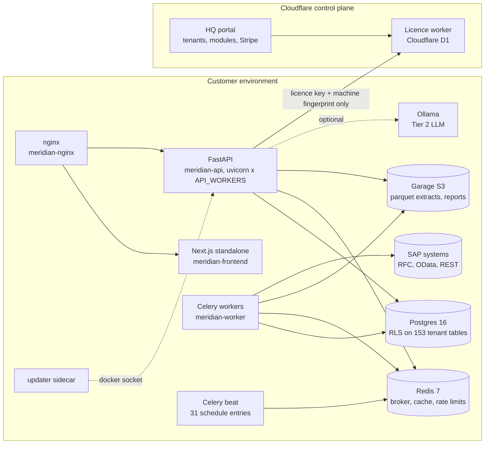
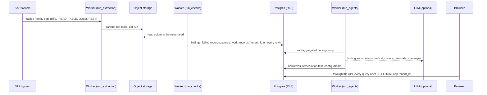

# Architecture

What the product is made of, how data moves through it, and where the boundaries are. Every count is
measured in this repository at commit `5cf7161c` (tag `v0.0.511-25`, branch `m2-complete`); the command
that reproduces it is named next to it or in [README.md](README.md). Older design notes
(`docs/ARCHITECTURE.md`, `CLAUDE.md`) predate several figures here; where they differ, this document was
measured and they were not (the differences are listed in [roadmap-and-debt.md](roadmap-and-debt.md), D-20).

## 1. Components

Meridian is two separate systems. The **customer deployment** runs inside the customer's own environment
and holds all SAP data. The **control plane** (Meridian HQ) runs on Cloudflare and holds licences and
billing only.



| Component | Source | Image | Notes |
|---|---|---|---|
| API | `api/` (125 route modules, 120 `include_router` calls, 176 service modules) | `docker/Dockerfile.api.prod` | 693 operations on 594 paths in the OpenAPI schema (401 GET, 187 POST, 49 PUT, 37 DELETE, 19 PATCH) |
| Workers and beat | `workers/` (60 files) | `docker/Dockerfile.worker.prod` | Celery; beat has 31 entries in `workers/scheduler.py` |
| Check engine | `checks/` (21 check-type classes, 8,380 rules in YAML) | inside API and worker | deterministic, see section 4 |
| Agents | `agents/` (6-node LangGraph graph) | inside worker | see section 6 |
| SAP connectors | `sap/` | inside API and worker | RFC, OData V2/V4, REST, see section 7 |
| Schema | `db/schema.py`, `db/migrations/versions/` (114 files, head `116`) | inside API | Alembic runs at API start (`docker/entrypoint.api.sh`) |
| Frontend | `frontend/` (476 TS/TSX files, 85,386 lines) | `docker/Dockerfile.frontend.prod` | Next.js 16.4.1, React 19.2.3, standalone output |
| Edge | `docker/nginx/meridian.conf` | `docker/Dockerfile.nginx` | the only published ports (80, 443) |
| Object storage | Garage v2.4.1 | `docker/Dockerfile.garage` | AGPL-3.0, unmodified, own container (see [licences.md](licences.md)) |
| Updater | `updater/main.py` | `docker/Dockerfile.updater` | holds the Docker socket; pulls and restarts on request |
| Control plane | `cloudflare/` (portal, licence-worker, llm-proxy, install-worker) | Cloudflare Workers | never receives SAP data |

Size (`python3 scripts/diligence_counts.py`): Python 89,071 lines in `api/`, 12,900 in `workers/`, 7,715 in
`checks/`, 14,860 in `sap/`, 15,027 in `db/` (mostly migrations), 2,287 in `agents/`; tests 81,662 lines.

## 2. Data flow



Upload is the second entry point: `POST /api/v1/upload` (`api/routes/upload.py`) validates magic bytes,
maps columns to SAP `TABLE.FIELD`, sanitises formula injection and writes the same parquet layout.
Write-back to SAP (`api/routes/writeback.py`, `api/services/golden_writeback.py`) is the only path that sends
data to SAP, and it requires an approved fix batch.

## 3. Tenancy and row-level security

```
request ──> LocalAuthMiddleware (JWT, API key)  ──> TenantMiddleware (tenant_id from the token)
        ──> get_db(): SET LOCAL app.tenant_id = '<uuid>'  ──> every query
Postgres: ENABLE + FORCE ROW LEVEL SECURITY, policy tenant_isolation:
          USING (tenant_id = current_setting('app.tenant_id')::uuid)
Role:     the API and workers connect as meridian_app (no superuser, no BYPASSRLS);
          migrations run as the owner role meridian (DATABASE_URL_MIGRATE)
```

- Every table with a `tenant_id` column has RLS enabled: 153 of 153 on a database migrated to head `116`,
  152 of them also `FORCE`d (the exception, `system_update_log`, is debt item D-07). Measured live with
  `python3 scripts/diligence_counts.py --rls`; the static guard is `tests/test_rls_conformance.py`, which
  fails the build when a model with `tenant_id` has no RLS-enabling migration. The table list is in
  [security.md](security.md), section 5.
- The session variable is set in `api/deps.py:get_db` (`SET LOCAL`, transaction-scoped) and in the workers'
  shared engine (`workers/db.py`).
- The non-superuser role is created by migration 040 and written into `.env` by `scripts/meridian-deploy.sh`
  (lines 574 to 576). `docs/ops/rls-hardening.md` is the runbook for deployments installed before 040.
- A deployment is single-customer by design (EULA section 2), but the schema is multi-tenant, so the same
  code serves several business units or a hosted model without change.

## 4. The deterministic check engine

```
checks/rules/<system>/<module>.yaml          hand-written rules (5,623, enabled)
checks/rules/<system>/<module>.generated.yaml DDIC-derived rules (2,757, shipped disabled)
        │  checks.runner.module_rules() merges them; tenant overrides from the rules table
        ▼
checks/frames.py   per-table frames, grain resolution over sap/dictionaries/joins.yaml
        ▼
checks/types/*_check.py   21 check classes (BaseCheck -> CheckResult with pass_rate, counts)
        ▼
findings, failing records, record_issues, work_records   (workers/tasks/run_checks.py)
```

- 8,380 rules across 47 modules and 5 rule families (ECC 6,004, SuccessFactors 1,556, warehouse 581,
  Ariba 141, Concur 97, Z-tables 1). By check class: referential 2,600, cross-field 1,944, null 1,181,
  exists 978, domain value 915, regex 361, uniqueness 201, freshness 108, others 74. Severity: critical 387,
  high 3,933, medium 2,959, low 1,093, info 8. Command: `python3 scripts/diligence_counts.py`.
- Generated rules come from the SAP Data Dictionary bundle by `scripts/generate_ddic_rules.py`; CI checks
  they are current (`--check`) and that every shipped rule reconciles with the field dictionary
  (`python -m checks.rule_reconciler --strict`), both in `.github/workflows/unit-tests.yml`.
- Null detection belongs to `null_check` only; regex and domain checks exclude nulls; `cross_field_check`
  uses `DataFrame.eval`.
- A 400,000-row extract runs inside a 60 second budget with exact counts: `tests/checks/test_perf_400k.py`
  (opt-in, `pytest -m perf`), run weekly by `.github/workflows/perf-400k.yml`.

## 5. Scoring

```
per rule      pass_rate = passing records / records in the rule's population (record level, not pass/fail)
per dimension severity-weighted mean of the rules in that dimension      (api/services/scoring.py)
composite     0.25 completeness + 0.25 accuracy + 0.20 consistency
            + 0.10 timeliness  + 0.10 uniqueness + 0.10 validity        (DEFAULT_WEIGHTS, per-tenant override)
cap           1 critical rule over tolerance -> at most 85; 2 or more -> at most 70   (_cap)
reported      raw_score (before cap) and composite_score (after), with the rule ids that capped it
```

A dimension with no measured rule is `None`, not 100 (`score_module`). The ruler in the UI draws the same
six segments, the raw tick and the capped number. Rules declaring a dimension outside the six (66
`lifecycle`, 2 `freshness`) do not enter the score (debt item D-08).

## 6. Agents and where the model is used

```
analyst -> config_matching -> config_impact -> remediation -> readiness -> report_agent -> END
            (agents/orchestrator.py, LangGraph StateGraph over agents/state.py:AgentState)
```

| Node | Model? | What it does without a model |
|---|---|---|
| analyst | optional | `agents/deterministic.py:run_deterministic_analyst` groups root causes |
| config_matching | optional | rule-based matching of findings to configuration |
| config_impact | never | 53 rules in `db/seeds/config_impact_rules.yaml` map check ids to blocked or degraded SAP features |
| remediation | optional | templated fix text |
| readiness | optional | deterministic readiness verdicts |
| report_agent | optional | `agents/narrator.py`, 30 hand-written templates |

The graph's input is `findings_summary`: check id, module, severity, dimension, affected and total counts,
pass rate and message. `tests/agents/test_state.py::test_findings_summary_no_raw_data` and
`tests/agents/test_prompts.py::test_no_prompt_contains_raw_data_references` hold that boundary. Every number
a user sees comes from the check engine and scoring; the model writes prose around numbers it is given.
With `LLM_PROVIDER=none` the product runs fully (`llm/provider.py:llm_is_noop`).

Outside the graph, 15 further modules call the model, all optional and all off when no provider is set:
column matching on upload, glossary enrichment, semantic value matching, survivorship tie-breaks, natural
language query, rule authoring, AI triage, impact scoring and narratives
(`grep -rln "safe_invoke\|get_llm(" api agents workers llm` lists 21 files: these 15, the 5 agent nodes and
`llm/provider.py`). Some of these send sample field values, not only
aggregates; [security.md](security.md) section 9 states exactly which, and the redaction applied.

Providers (`llm/provider.py`): Tier 1 cloud API (Anthropic, Azure OpenAI), Tier 1.5 Ollama Cloud, Tier 2
bundled Ollama inside the deployment, Tier 3 a customer endpoint, or none. Calls are logged to
`llm_audit_log`, have a 120 s request timeout and a circuit breaker.

## 7. Connector layer

| System type | Connector | Protocol | Auth |
|---|---|---|---|
| ECC, S/4HANA on-premise, eWMS | `sap/rfc.py` (PyRFC over the customer-supplied SAP NW RFC SDK) | RFC | user and password |
| S/4HANA Cloud | `sap/s4hana_cloud.py` | OData V4 | OAuth 2.0 |
| SAP BTP | `sap/btp.py` | OData V2/V4 | OAuth 2.0 (XSUAA) |
| SuccessFactors | `sap/successfactors.py` | OData V2 | Basic or OAuth 2.0 |
| Concur | `sap/concur.py` | REST v4 | OAuth 2.0 |
| Ariba | `sap/ariba.py` | REST | OAuth 2.0 and API key |

Dispatch is `api/services/connectivity_manager.py` on `sap_systems.system_type`
(`CLOUD_SYSTEM_TYPES = ("successfactors", "concur", "ariba", "s4hana_cloud", "btp")`). Credentials are
AES-256-GCM encrypted per tenant (`api/services/credential_store.py`). `sap/extraction_registry.py` maps
modules to tables; `sap/spro_tables.py` and `sap/baseline_config.py` read configuration live or fall back to
a baseline. Extraction is read-only; the RFC SDK is never in the repository or the published images
(`vendor/nwrfcsdk/README.md`).

## 8. Control plane

```
HQ portal (cloudflare/portal, Next.js on Workers)  ── tenants, module toggles, rules, Stripe
Licence worker (cloudflare/licence-worker, D1)     ── POST /api/licence/validate
LLM proxy (cloudflare/llm-proxy)                   ── optional Tier 1 routing for customers without their own key
Install worker (cloudflare/install-worker)         ── serves the install script
```

The customer API sends the licence key and a SHA-256 machine fingerprint (hostname and MAC hash,
`api/middleware/licence.py:_get_machine_fingerprint`) every 6 hours; it never sends SAP data. Offline and
air-gapped installs verify an RS256 token (`MERIDIAN_LICENCE_TOKEN`) or an HMAC-signed file instead
(`LICENCE_MODE=offline|airgap`). Behaviour when the licence worker is unreachable is in
[operations.md](operations.md), section 8.

## 9. Frontend

```
┌──────────────┬─────────────────────────────────┬──────────────────┐
│ MAP (280 px) │ CANVAS                          │ INSPECTOR (400)  │
│ systems ->   │ landscape /  object /o/{s}/{m}  │ ?open=kind:id    │
│ objects,     │ rule /r/{id}  work /work        │ 38 kinds         │
│ score ruler  │ run /run/{id}  people  reports  │ (lib/v2/hooks.ts │
│ per row      │ rules  admin  share  s/{id}     │  OpenKind)       │
└──────────────┴─────────────────────────────────┴──────────────────┘
```

- One interface, served at the root from `frontend/app/(v2)` (25 pages) plus 7 sign-in and licence pages in
  `app/(auth)`. Old URLs redirect permanently (`frontend/docs/guide/redirects.md`, `e2e/redirects.spec.ts`).
- One component library, `frontend/design/v2/`: the shell (map, canvas, inspector), the ruler, a virtual
  grid (100,000 rows rendered with only the visible rows drawn, `design/v2/__tests__/Grid.test.tsx`), the
  command line, inspector bodies in `design/v2/inspector/registry.tsx` (36 registered bodies; the rest are
  drawn by `Inspector.tsx`).
- Tokens: `frontend/design/v2/tokens.css` defines 65 `--m2-*` custom properties for light and dark.
  `npm run lint:tokens` rejects raw colours, gradients, blur, ad hoc shadows and motion literals outside the
  token files; its allow-list is empty.
- Localisation: every visible string goes through `lib/v2/i18n` (`t`, `tn`, `lc`) with English, German and
  Japanese catalogues. `node scripts/i18n-extract.mjs` reports 4,074 keys used, 4,231 in the catalogue,
  0 untranslated, 0 missing, 0 gaps; CI runs it.
- Fixture mode: `?fixture=1` answers every read from `lib/api/v2/fixtures` (21 files) so tests, recordings
  and the demo run with no backend; `?persona=lead|steward|owner|basis|process` and `?role=<role>` shape the
  first screen and the permissions.
- Auth in the browser: the session JWT is kept in `localStorage` and sent as a bearer header; an httponly,
  SameSite=Lax cookie carries the same token for downloads and video. `frontend/middleware.ts` keeps
  signed-out users off the app shell (see [security.md](security.md) section 3 and D-12).
- Help: 31 chapters in `frontend/docs/guide`, 26 recordings `guide2-*.mp4`, every route mapped to a chapter
  (`lib/v2/help.test.ts`).
